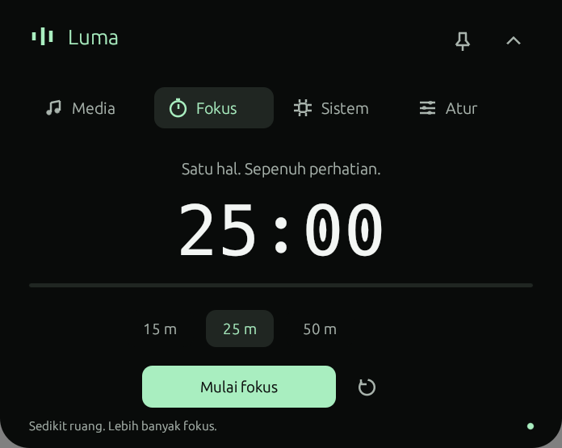
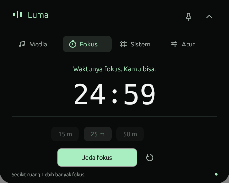
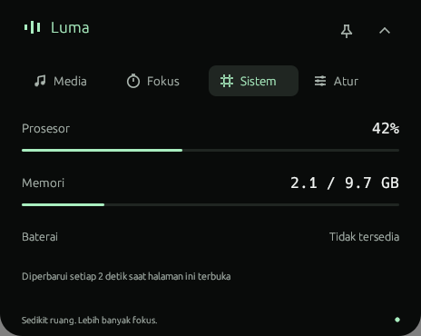
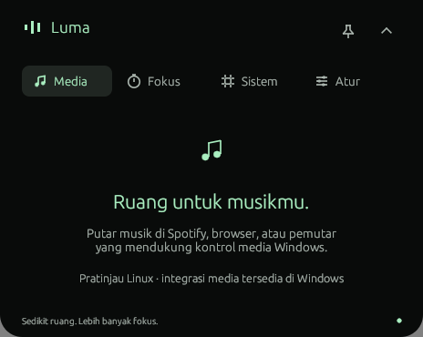
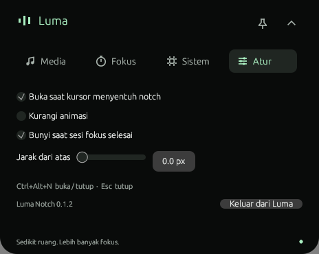

<p align="center"></p>

<h1 align="center">Luma Notch</h1>

<p align="center"><strong>Ruang kecil untuk musik dan fokus.</strong><br>Notch terinspirasi Mac untuk Windows, dibuat dengan Rust.</p>

<p align="center">
  <a href="#mulai"><strong>Mulai</strong></a> ·
  <a href="#galeri">Tampilan</a> ·
  <a href="docs/BUILDING.md">Build dari sumber</a> ·
  <a href="docs/VALIDATION.md">Status pengujian</a>
</p>

<p align="center"><code>Windows 10 / 11</code> · <code>Native Rust</code> · <code>Portable</code> · <a href="LICENSE">MIT</a></p>

<p align="center"></p>

Luma tinggal di tengah atas layar. Saat ringkas, ia menampilkan timer, judul musik, atau jam. Sentuh dengan kursor untuk membuka kontrol, lalu lanjutkan pekerjaanmu.

Aplikasi native tanpa WebView, akun, atau layanan server. Gerak spring tetap menyambung saat arahnya dibalik; isi panel masuk bertahap dengan layout yang tetap. Pembacaan CPU dan RAM berjalan hanya ketika halaman Sistem terbuka.

<sub>Demo dan galeri berasal dari aplikasi yang berjalan di Linux untuk pratinjau UI. Integrasi Windows belum diuji langsung; bukti dan batas pengujian ada di <a href="docs/VALIDATION.md">catatan validasi</a>.</sub>

<details>
<summary><strong>Lihat animasi buka dan tutup</strong></summary>

<p align="center"></p>

</details>

## Yang bisa dilakukan

| Halaman | Kegunaan |
| --- | --- |
| **Media** | Judul, artis, posisi lagu, play/pause, sebelumnya, dan berikutnya melalui kontrol media Windows. Tombol mengikuti kemampuan pemutar. |
| **Fokus** | Sesi 15, 25, atau 50 menit, jeda, lanjutkan, reset, dan bunyi saat selesai. Countdown tetap terlihat ketika notch diringkas. |
| **Sistem** | CPU dan RAM setiap 2 detik selama halaman terbuka. Baterai dan status listrik ditampilkan jika perangkat menyediakannya. |
| **Atur** | Pilih monitor dan jarak dari atas; atur hover, animasi, dan bunyi. Perubahan tersimpan di perangkat. |

Notch selalu di atas, tanpa bingkai atau tombol taskbar. Pin mempertahankan panel hover. Ikon tray menyediakan akses ke panel, timer, pengaturan, dan keluar aplikasi. Windows membatasi aplikasi ke satu instance per sesi pengguna.

## Galeri

| Fokus | Sistem |
| --- | --- |
|  |  |
| **Media** | **Pengaturan** |
|  |  |

<p align="center"><br><sub>Ringkas saat kamu kembali bekerja. Nilai pada galeri berasal dari mesin pengembangan.</sub></p>

## Mulai

**Windows 10 versi 1809 atau lebih baru / Windows 11, x64**, dengan driver OpenGL 2.0+.

1. Ekstrak ZIP portable Luma Notch yang disertakan bersama pengiriman proyek, atau unduh artifact **LumaNotch-windows-x64** dari workflow **Build and test** setelah repo dijalankan di GitHub Actions.
2. Jalankan **`luma-notch.exe`**. Notch muncul di atas monitor utama.
3. Sentuh notch dengan kursor sebentar, klik, atau tekan **`Ctrl+Alt+N`**.

Tidak perlu installer atau hak administrator. Aplikasi belum ditandatangani dengan sertifikat penerbit dan tidak mengubah pengaturan startup Windows.

Untuk langsung membuka panel:

```powershell
.\luma-notch.exe --expanded
```

### Kendali cepat

| Tindakan | Cara |
| --- | --- |
| Buka / tutup panel | `Ctrl+Alt+N` |
| Tutup panel | `Esc` |
| Buka lewat hover | Tahan kursor di notch sekitar 240 ms |
| Pindah halaman | Klik tab, atau **gulir di header**; ke bawah untuk halaman berikutnya, ke atas untuk sebelumnya |
| Biarkan panel hover terbuka | Klik ikon pin |
| Keluar | Menu tray atau **Atur → Keluar dari Luma** |

Gulir pada isi halaman tetap untuk kontrol halaman tersebut. Gerakan kecil trackpad dikumpulkan dan perpindahan diberi jeda agar satu gerakan tidak melompat banyak halaman.

Panel yang dibuka lewat klik atau shortcut tetap terbuka sampai ditutup. Panel hover menutup sekitar 650 ms setelah kursor keluar, kecuali dipin. Mode **Kurangi animasi** langsung menampilkan state akhir.

## Data tetap di perangkat

- Tidak ada telemetri jaringan, akun, atau sinkronisasi server.
- Metadata dan statistik dibaca dari sistem lokal. Pemutar harus menyediakan sesi Windows System Media Transport Controls, seperti Spotify atau browser yang mendukungnya.
- CPU/RAM berhenti dibaca saat halaman Sistem ditutup. Baterai ringkas diperiksa setiap 30 detik dan ikut diperbarui saat halaman Sistem aktif.
- Pengaturan tersimpan di `%APPDATA%\Luma\LumaNotch\config\settings.json`. JSON rusak memakai default sementara dan menampilkan pesan di Atur; file asli dipertahankan sampai kamu menyimpan perubahan.
- Sesi fokus dan jumlah sesi hanya bertahan selama aplikasi berjalan. Keluar aplikasi membatalkan timer.

## Build dan pengembangan

Dengan Rust stable, Visual Studio Build Tools, dan Windows SDK:

```powershell
cargo build --locked --release
.\target\release\luma-notch.exe
```

Panduan toolchain, cross-build, tes, struktur kode, dan artifact CI ada di **[docs/BUILDING.md](docs/BUILDING.md)**. Bukti uji dan checklist Windows ada di **[docs/VALIDATION.md](docs/VALIDATION.md)**.

### Status

Luma masih pada tahap awal. Build Windows dan tes logika dijalankan dari Linux; media, tray, shortcut global, click-through, dan monitor dengan DPI berbeda masih memerlukan pengujian langsung di Windows. Galeri tidak menyatakan integrasi tersebut telah diuji.

Jika media belum tampil, pastikan pemutar aktif dan mendukung kontrol media Windows. Jika shortcut dipakai aplikasi lain, klik notch atau gunakan tray. Atur jarak dan monitor jika notch menutupi kontrol aplikasi lain.

Saat melaporkan masalah, sertakan versi Luma, versi Windows, skala DPI/monitor, pemutar yang dipakai, dan langkah untuk mengulanginya.

## Referensi dan kredit

- [Poni / Oyen Poni](https://github.com/lucacadalora/poni) menjadi referensi untuk navigasi header, pembacaan sistem sesuai kebutuhan, dan susunan README. [Catatan kajian](docs/REFERENCE_PONI.md) menghubungkannya ke sumber yang diperiksa.
- Dibangun dengan [egui/eframe](https://github.com/emilk/egui), [windows-rs](https://github.com/microsoft/windows-rs), dan [sysinfo](https://github.com/GuillaumeGomez/sysinfo).
- Logo, ikon, screenshot, dan rekaman yang ditampilkan adalah milik proyek Luma. Screenshot diambil dari aplikasi yang berjalan.

Kode berlisensi **[MIT](LICENSE)**. Proyek independen, tidak berafiliasi dengan Apple.
