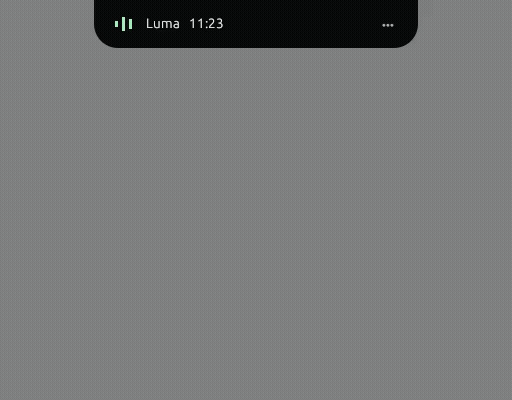

# Luma Notch

Notch terinspirasi Mac untuk Windows, ditulis dengan Rust. Overlay hitam di tengah atas layar membuka akses ke musik, timer fokus, dan status perangkat, tanpa akun atau WebView.



Rekaman UI native di Linux pada skala 100%, termasuk membalik arah saat transisi. Integrasi OS Windows tidak berjalan pada pratinjau ini.

## Fitur

- **Media:** judul, artis, posisi, dan kontrol play/pause, sebelumnya, berikutnya melalui Windows System Media Transport Controls. Mendukung aplikasi yang menyediakan sesi media, seperti Spotify dan browser tertentu. Kontrol mengikuti kemampuan pemutar.
- **Fokus:** pilihan 15, 25, atau 50 menit, jeda, lanjutkan, reset, dan bunyi Windows saat selesai. Sesi tetap berjalan saat panel ditutup; keluar aplikasi membatalkan sesi. Jumlah sesi dihitung sejak aplikasi dibuka.
- **Sistem:** pemakaian CPU dan RAM diperbarui setiap 2 detik; baterai dan koneksi listrik ditampilkan jika perangkat menyediakannya.
- **Overlay:** selalu di atas, tanpa bingkai/taskbar, sudut transparan, buka saat hover atau klik, pin panel, dan animasi spring yang menyambung saat arah dibalik. Isi panel masuk lewat fade dan mask tanpa perubahan lebar layout; mode kurangi animasi tersedia.
- **Pengaturan:** jarak dari tepi atas, monitor, hover, animasi, dan bunyi disimpan secara lokal.
- **Windows:** ikon tray dengan menu keluar, shortcut global `Ctrl+Alt+N`, serta satu instance per sesi pengguna.

## Menjalankan di Windows

Windows 10 versi 1809 atau lebih baru / Windows 11, x64, dengan driver OpenGL 2.0+.

1. Ekstrak `LumaNotch-windows-x64.zip` dari hasil build.
2. Jalankan `luma-notch.exe`. Notch muncul di atas monitor utama.
3. Sentuh notch dengan kursor selama sekitar seperempat detik, klik, atau tekan `Ctrl+Alt+N`.

Klik tab **Media**, **Fokus**, **Sistem**, atau **Atur**. `Esc` menutup panel. Panel yang dibuka dengan hover menutup setelah kursor keluar; panel yang dibuka dengan klik/shortcut tetap terbuka sampai ditutup. Pin mempertahankan panel hover. Menu tray dan tab Atur menyediakan **Keluar dari Luma**.

Untuk langsung membuka panel:

```powershell
.\luma-notch.exe --expanded
```

Aplikasi portable ini belum ditandatangani dengan sertifikat penerbit. Windows dapat menampilkan SmartScreen. Tidak memerlukan hak administrator dan tidak mengubah pengaturan startup Windows.

## Build dari sumber

Pasang [Rust stable](https://rustup.rs/) dan **Visual Studio Build Tools** dengan workload **Desktop development with C++** serta Windows SDK. Lalu:

```powershell
cargo build --locked --release
.\target\release\luma-notch.exe
```

Verifikasi:

```powershell
cargo fmt --all -- --check
cargo clippy --locked --all-targets -- -D warnings
cargo test --locked --all-targets
```

Workflow GitHub Actions menjalankan pemeriksaan Windows dan menyiapkan ZIP portable pada setiap push, PR, atau eksekusi manual. Tidak ada publikasi release otomatis.

## Pengaturan dan privasi

Pengaturan disimpan melalui direktori konfigurasi pengguna Windows, umumnya `%APPDATA%\Luma\LumaNotch\config\settings.json`. Tidak ada telemetri jaringan atau layanan server. Aplikasi membaca metadata media aktif dan statistik sistem lokal. Pengaturan rusak menghasilkan pesan di tab Atur dan default sementara; file asli tetap ada sampai Anda menyimpan perubahan pengaturan.

## Struktur

```text
src/app.rs               UI notch, animasi, dan interaksi
src/focus.rs             state machine timer, diuji tanpa sleep
src/motion.rs            spring analitik dan fade, independen refresh rate
src/config.rs            konfigurasi JSON dan validasi
src/telemetry.rs         worker CPU/RAM/baterai
src/platform/windows.rs  WinRT media, tray, shortcut, monitor, mutex
src/icons.rs             ikon vektor
docs/VALIDATION.md       bukti verifikasi dan checklist Windows
```

Media dan metrik berjalan pada worker terpisah agar pembacaan OS tidak menahan rendering. Timer memakai durasi monotonik, bukan jam kalender. Worker berhenti saat aplikasi berakhir. Linux mendukung pratinjau UI dan tes logika inti; integrasi OS khusus Windows dinonaktifkan pada pratinjau.

## Batasan

- Metadata, durasi, dan tombol bergantung pada dukungan sesi media pemutar. Tidak ada sesi aktif berarti panel kosong, bukan data simulasi.
- Overlay dapat menutupi bagian atas aplikasi lain. Atur jarak/monitor jika bertabrakan dengan kontrol aplikasi.
- Pemindahan monitor dengan DPI berbeda, fullscreen eksklusif, dan perilaku tray harus diverifikasi pada Windows; lihat checklist validasi.
- Shortcut yang sudah dipakai aplikasi lain mungkin tidak terdaftar. Menu tray dan klik notch tetap tersedia.
- Pengujian runtime Windows belum dilakukan di lingkungan pengembangan Linux ini. Build Windows dan pemeriksaan kode lulus; checklist perangkat Windows ada di `docs/VALIDATION.md`.

Lisensi MIT. Proyek independen, tidak berafiliasi dengan Apple.
