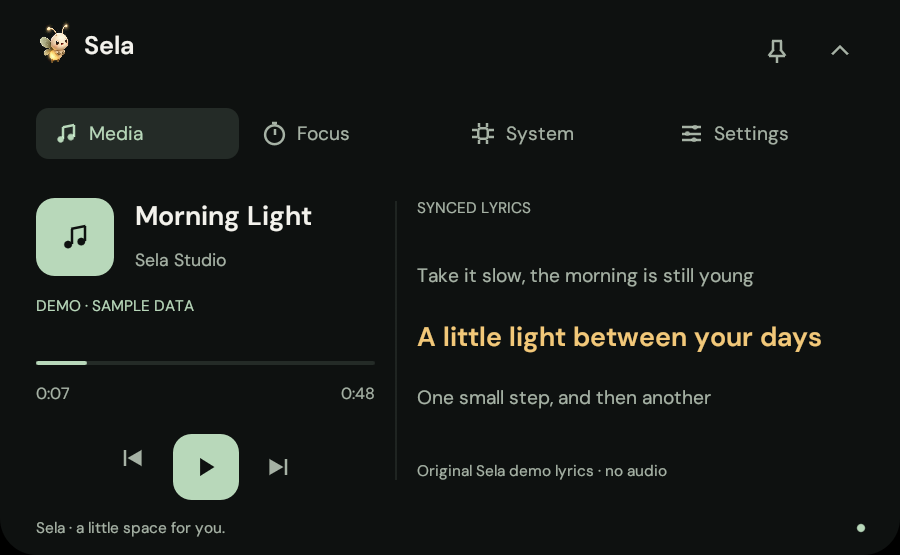
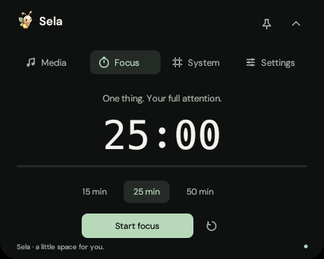
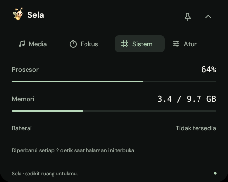
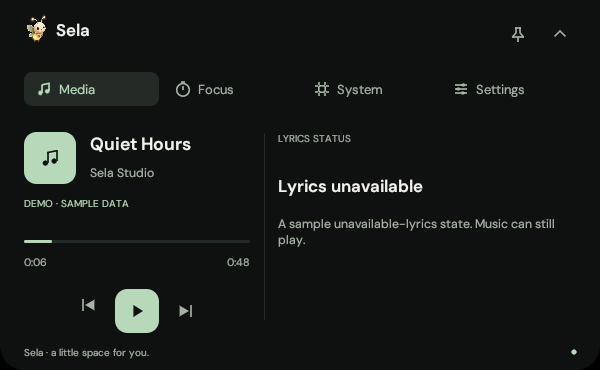
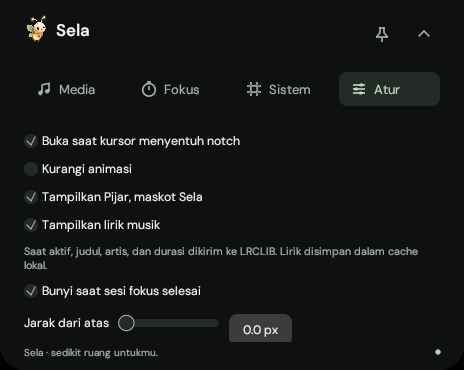

<p align="center"></p>

<h1 align="center">Sela</h1>

<p align="center"><strong>Keep music close. Stay focused.</strong><br>A Windows notch built with Rust, accompanied by Pijar the firefly.</p>

<p align="center">
  <a href="#get-started"><strong>Get started</strong></a> ·
  <a href="#music-and-lyrics">Music & lyrics</a> ·
  <a href="docs/BUILDING.md">Build</a> ·
  <a href="docs/VALIDATION.md">Validation</a>
</p>

<p align="center"><code>Windows 10 / 11</code> · <code>Native Rust</code> · <code>Portable</code> · <a href="LICENSE">MIT</a></p>

<p align="center"></p>

Sela lives at the top center of your screen. Open the panel to control music or start a focus session. Close it, and the song title and one current lyric line stay with you.

Charcoal, sage, and amber keep the panel quiet. Width and height use continuous springs that preserve their motion when you reverse direction. Pijar adds a little warmth; you can hide the mascot in Settings.

<sub>The gallery shows the Rust app running on Linux. Music and lyrics in these images use original demo data without audio. Windows integration still requires testing on a Windows device; see the <a href="docs/VALIDATION.md">validation evidence and limits</a>.</sub>

## Music and lyrics

<p align="center"></p>

- **Windows media controls:** metadata, playback position, play/pause, previous, and next through Windows System Media Transport Controls. Buttons follow the player's capabilities.
- **Synchronized lyrics:** the active line is highlighted in amber; the expanded panel shows the previous and next lines. Lyrics follow the player's position, including pauses and position changes.
- **Lyric alignment:** the collapsed notch centers the current lyric within the area to the right of the song title and divider. Expanded lyrics remain left-aligned.
- **Readable text:** long titles and lyrics truncate with an ellipsis; hover to read the full text. Lyrics without timestamps appear as plain text in the expanded panel.
- **Clear states:** loading, connection errors, instrumental tracks, incomplete metadata, and unavailable lyrics have their own messages. Results for an earlier song cannot replace the current song's lyrics.

Lyrics come from [LRCLIB](https://lrclib.net). Availability, content, and timing depend on the source data. Sela matches the title, artist, and duration; it does not infer timing from plain lyrics. The timeline displays playback position; seeking controls are not implemented yet.

## Room to work

The app currently uses Indonesian interface labels. Their English meanings are included below.

| Page | What it does |
| --- | --- |
| **Media** | Windows music controls and lyrics in a 600×370 panel, or a 580×54 collapsed music notch. |
| **Focus (`Fokus`)** | Sessions of 15, 25, or 50 minutes, with pause, resume, reset, and an optional completion sound. An active focus countdown takes priority in the collapsed notch. |
| **System (`Sistem`)** | CPU and RAM readings every 2 seconds while the page is open, plus battery and power status when available. |
| **Settings (`Atur`)** | Monitor, top offset, hover, reduced motion, sound, lyrics, and mascot preferences. Settings are stored locally. |

| Focus | System |
| --- | --- |
|  |  |
| **Unavailable lyrics** | **Settings** |
|  |  |

Sela stays on top, without a window frame or taskbar button. The tray provides access to the panel, focus timer, settings, and exit. Pinning keeps a hover-opened panel visible. A single instance per Windows session prevents duplicate overlays.

## Get started

**Windows 10 version 1809 or later / Windows 11, x64**, with an OpenGL 2.0+ driver.

1. Open the **[latest GitHub Release](https://github.com/YosuaPWH/sela/releases/latest)** and download **`Sela-<version>-setup-x64.exe`**.
2. Run the installer, then open **Sela** from the Start Menu.
3. Hover over the notch briefly, click it, or press **`Ctrl+Alt+N`**. Play music in a player that supports Windows media controls.

For portable use, extract **`Sela-<version>-windows-x64.zip`** and run **`sela-notch.exe`**, or download the standalone executable from the same release. **`SHA256SUMS.txt`** provides hashes for all three files.

The installer runs for the current user, provides a Start Menu shortcut and uninstaller, and does not require administrator privileges. The app and installer are unsigned. Sela does not add itself to Windows startup automatically.

```powershell
.\sela-notch.exe --expanded
```

To explore the interface without a media player:

```powershell
.\sela-notch.exe --demo --expanded
```

Demo mode is labelled and uses no audio or LRCLIB requests. Previous/Next cycles through five original examples: synchronized lyrics, long text, unavailable lyrics, plain lyrics, and an instrumental track. Launch without `--demo` to use Windows media sessions.

| Action | Control |
| --- | --- |
| Open / close | `Ctrl+Alt+N` |
| Close | `Esc` while the panel has focus |
| Open on hover | Keep the pointer over the notch for about 240 ms |
| Switch pages | Click a tab or scroll over the header |
| Keep a hover-opened panel visible | Click the pin |
| Exit | Tray menu, or **Settings (`Atur`) → `Keluar dari Sela`**; scroll down in Settings |

Panels opened by a click or shortcut stay open until closed. A hover-opened panel closes about 650 ms after the pointer leaves, unless pinned. **Reduce motion (`Kurangi animasi`)** displays the final state immediately. Disabling lyrics uses the shorter music notch; an active focus timer takes priority in collapsed mode.

## Data and connectivity

Sela has no accounts or telemetry. Player metadata and system statistics are read from your device. **When lyrics are enabled**, the track title, artist, and duration are sent to LRCLIB over HTTPS. Turn off **Settings (`Atur`) → `Tampilkan lirik musik`** to stop new lookups. An in-flight request may finish its connection, but its result will be ignored.

- Successful lyric results are cached locally for 30 days; not-found results for 1 day. Connection failures are not cached. A valid cache entry can be used offline.
- Settings: `%APPDATA%\Sela\Sela\config\settings.json`. Cache: `%LOCALAPPDATA%\Sela\Sela\cache\lyrics`.
- Legacy Luma settings are read if Sela settings do not exist yet. Subsequent saves use the Sela location, preserving the old file.
- Invalid settings JSON falls back to defaults and displays a message in Settings. The original file is not overwritten until you save a change.
- CPU/RAM sampling stops when the System page closes; the collapsed battery indicator is checked every 30 seconds. The focus timer and session count end when the app exits.

## Development

```powershell
cargo build --locked --release
.\target\release\sela-notch.exe
```

See the [build guide](docs/BUILDING.md), [release guide](docs/RELEASING.md), [validation notes](docs/VALIDATION.md), [design system](DESIGN.md), and [product scope](PRODUCT.md). The Windows x64 cross-build, formatting, Clippy, and 22 tests passed on Linux. Windows runtime behavior—including media, tray, global shortcuts, click-through, and mixed-DPI monitors—still requires direct testing on Windows.

Version tags such as `v0.2.0` automatically build the executable, portable ZIP, and installer, test installation/uninstallation, and publish the files to GitHub Releases. The tag must match the package version in `Cargo.toml`; see the [release guide](docs/RELEASING.md) for subsequent releases.

## Credits

- [Poni / Oyen Poni](https://github.com/lucacadalora/poni): a reference for header navigation, on-demand system sampling, and README structure. See the [source review](docs/REFERENCE_PONI.md).
- [egui/eframe](https://github.com/emilk/egui), [windows-rs](https://github.com/microsoft/windows-rs), [sysinfo](https://github.com/GuillaumeGomez/sysinfo), [reqwest](https://github.com/seanmonstar/reqwest), and [LRCLIB](https://lrclib.net).
- DM Sans is included under the [SIL Open Font License](assets/OFL.txt). Pijar is a project-generated asset; its [prompt and provenance](assets/README.md) are included. Demo lyrics are original Sela text.

Code is licensed under **[MIT](LICENSE)**. This is an independent project, unaffiliated with Apple, Spotify, or LRCLIB.
